<h1 align="center">Hi, I'm Daniel Ian Otieno</h1>
<h3 align="center">Full-Stack Developer · PHP/MySQL · React · Firebase · Cloudflare · Nairobi, Kenya</h3>

  
  
  

<b>I build the systems people use every day at work, then teach the next class how to build them.</b>

---

## About me

Four years of hands-on work on production **PHP/MySQL, Firebase and Cloudflare** systems, including a school management platform used daily across seven staff roles and 200+ students. I own projects end to end: database design, backend logic, REST APIs and the frontend, on real client sites with live traffic and shared-hosting limits. Away from the keyboard, I draw portraits in graphite.

- **ICT Department Head** at Delhi College, Eastleigh: I run the college's web systems and teach the IBM Full Stack and IBM Java Developer programmes, networking and graphic design
- **Freelance full-stack developer** for businesses in Nairobi
- **Open to remote and freelance work.** See everything at [danielotieno.co.ke](https://danielotieno.co.ke)

---

## Projects

  

| # | Project | What I built | See it |
|---|---|---|---|
| 01 | **Delhi College** | Staffroom, a PHP/MySQL school management system used daily by seven staff roles, plus the results portals (200+ students moved from Firestore to MySQL) and the college website | [delhicollege.co.ke](https://delhicollege.co.ke) |
| 02 | **Kenya Ihsaan Auto Tyres** | Product catalogue rebuilt from Firebase onto PHP/MySQL with a seven-endpoint JSON API, an admin dashboard, accounts and receipts, and SEO groundwork | [kenyaihsaantyres.co.ke](https://kenyaihsaantyres.co.ke) |
| 03 | **Aroly Studio** | Portfolio and pattern-licensing site running on one Cloudflare Worker, with D1 for data, R2 for artwork and an admin behind Cloudflare Access | [arolystudio.com](https://arolystudio.com) |
| 04 | **Road Rush** | Night-time motorbike game on Thika Road built with React and canvas, with a saved leaderboard and touch controls | [Play it](https://danielotieno.co.ke/play/road-rush/) |
| 05 | **Couple of Sticks** | Real-time 1v1 spear-throwing game for the web and Android, with room codes, a deterministic physics engine and synthesised sound | [Play it](https://couple-of-sticks.web.app) |
| 06 | **Concrete Kings** | 1-on-1 3D streetball for Android in Java and libGDX, with a procedural player rig and a broadcast camera | [Download the APK](https://danielotieno.co.ke/#freelance) |

> **Why are these repositories private?** They hold client and employer code, so I keep them private to protect their systems and data.
> For more details, a demo or a code walkthrough, [email me](mailto:oderodanielotieno@gmail.com) or [message me on LinkedIn](https://www.linkedin.com/in/danielianotieno/).

**Drawings:** I also draw graphite portraits by hand. See the [gallery](https://danielotieno.co.ke/#drawings).

---

## Tech stack

**Languages**

  
  
  
  
  
  
  
  

**Frontend, backend and data**

  
  
  
  
  
  
  
  

**Mobile, games and tooling**

  
  
  
  
  
  
  
  

**Design and networking**

  
  
  

---

## Teaching

I head the ICT department at Delhi College, where I teach:

- IBM Full Stack Software Developer Professional Certificate
- IBM Java Developer Professional Certificate
- KNEC Diploma and Certificate in ICT
- Cisco Packet Tracer: network design, configuration and simulation labs
- Graphic Design: Adobe Photoshop and Illustrator
- Microsoft Office training for private and corporate clients

Worked code solutions for my courses are public here, each topic with its own README:
[C++](https://github.com/Daniel-Otieno-Fullstack-Developer/cpp-programming) ·
[Python](https://github.com/Daniel-Otieno-Fullstack-Developer/python-programming) ·
[Java](https://github.com/Daniel-Otieno-Fullstack-Developer/java-programming) ·
[JavaScript](https://github.com/Daniel-Otieno-Fullstack-Developer/javascript-programming) ·
[React](https://github.com/Daniel-Otieno-Fullstack-Developer/react-fundamentals)

---

<i>Open to remote and freelance work. <a href="https://danielotieno.co.ke/#contact">Let's talk about your project.</a></i>

